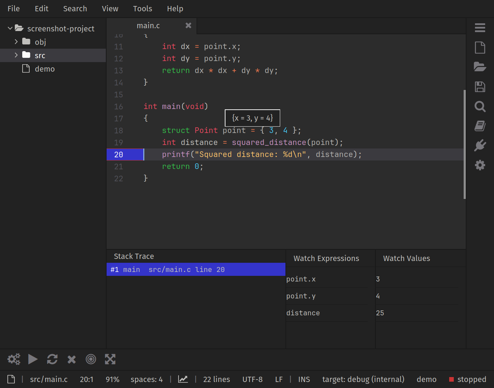

# Pragtical IDE

A collection of build and debugger plugins for
[Pragtical](https://github.com/pragtical/pragtical), with metapackages for common
language toolchains. LSP and Git support come from the maintained
[Pragtical LSP](https://github.com/pragtical/lsp) and
[SCM](https://github.com/pragtical/scm) plugins.



This fork targets the current Pragtical development runtime, including core
floating views, application menus, horizontal toolbars and `core.json`. Older
runtimes without those APIs are unsupported. The build and debugger plugins
remain experimental.

## Installation

Using [ppm](https://github.com/pragtical/plugin-manager):

```sh
ppm add https://github.com/pragtical/ide.git:master
ppm install ide --no-install-optional
```

Install `ide_c` for C/C++ tools, including the build plugin, debugger and language
server configuration. Other language metapackages are listed below. Build and debugger can also be
installed separately.

| Language | Metapackage |
| --- | --- |
| Bash | `ide_bash` |
| C/C++ | `ide_c` |
| Clojure | `ide_clojure` |
| CSS/LESS/SCSS | `ide_css` |
| D | `ide_d` |
| Go | `ide_go` |
| Haxe | `ide_haxe` |
| HTML | `ide_html` |
| Java | `ide_java` |
| JavaScript | `ide_javascript` |
| JSON | `ide_json` |
| Lua | `ide_lua` |
| PHP | `ide_php` |
| Python | `ide_python` |
| Rust | `ide_rust` |
| TeX | `ide_tex` |
| TypeScript | `ide_typescript` |
| YAML | `ide_yaml` |
| Zig | `ide_zig` |
| Web development (HTML/CSS/JS/TS/JSON and Emmet) | `ide_web` |

For a manual installation, copy `plugins/build`, `plugins/debugger` and optionally
`plugins/ide.lua` into your Pragtical user plugin directory. On Linux this is
usually `~/.config/pragtical/plugins`. The empty `ide.lua` module is a metapackage
entry; language servers and other dependencies must be installed separately.

## Build

The build plugin supports Make, CMake, Meson, Gradle wrappers, shell scripts and
an internal GCC/Clang build backend. It discovers targets from the current
project, or uses targets configured in its
[project module](https://pragtical.dev/docs/user-guide/configuration/#project-module).
Open that module with `core:open-project-module`.

```lua
local config = require "core.config"
config.plugins.build.targets = {
  { name = "debug", backend = "make", binary = "bin/app-debug" },
  { name = "release", backend = "make", binary = "bin/app-release" }
}
```

A target's `backend` selects its build system. Setting
`config.plugins.build.type = "make"` selects one backend for every target instead.
For the internal backend, the target's own `type` describes its output:
`"executable"`, `"static"` or `"shared"`.

For CMake and Meson, `name` identifies the configuration, `buildtype` chooses its
build type, `build_directory` optionally chooses an output directory, and
`build_target` optionally selects one build-system target. CMake uses build types
such as `Debug` and `Release`; Meson uses `debug` and `release`.

```lua
config.plugins.build.targets = {
  { name = "debug", backend = "cmake", buildtype = "Debug",
    build_directory = "build-debug", binary = "build-debug/app" }
}
```

CMake targets need an explicit `binary` to run or debug. Meson can discover the
first executable built by default; an explicit `binary` takes precedence.
Cleaning keeps configured CMake/Meson build directories intact.

The internal backend accepts `src` or `srcs`, `obj`, `cc`, `cxx`, `ar`, `ld`,
`cflags`, `cxxflags`, `ldflags`, `ignored_files` and per-file options in `files`.
It compiles `.c`, `.cc`, `.cpp` and `.cxx` files, tracks header dependencies and
links C++ sources with the C++ compiler. Flags can be strings or argument arrays.

```lua
config.plugins.build.targets = {
  { name = "debug", backend = "internal", type = "executable",
    srcs = { "src" }, binary = "bin/app", cflags = { "-g", "-O0" },
    cxxflags = { "-g", "-O0" } }
}
```

Shell targets accept `runner`, `command`, `arguments` and optional `args_clean`.
Gradle uses `gradlew` on Unix and `gradlew.bat` on Windows; its target name is the
wrapper task. Set `task = "executable"` for a runnable Gradle task.

Programs run asynchronously with captured output by default. Set
`config.plugins.build.terminal` to an external terminal's command prefix when
interactive input is needed, for example `{ "xterm", "-e" }`. Program arguments
support quotes and escaped spaces. A target can provide `binary_arguments` as a
default argument array; explicit argument history overrides it. Bare executable
names are resolved through PATH. The build output pane includes scrollbars
and clickable GCC/Clang/MSVC diagnostics, and its toolbar works with all
TreeView docking positions.

The Tools → Build menu lists available commands and their current bindings.
Defaults include Ctrl+B to build, Ctrl+Shift+B to clean, Ctrl+E to run,
Ctrl+Shift+E to enter program arguments, Ctrl+T to cycle targets,
Ctrl+Shift+T to select a target and F6 to toggle output. Ctrl+Shift+Alt+E selects
and runs a target without replacing the LSP completion binding.

See [the build API](plugins/build/README.md) to add a backend.

## Debugger

The default backend uses GDB's machine interface. Install GDB on your PATH, or
set `config.plugins.debugger.gdb_path` to its executable. Compile the program
with debug symbols and select its build target or set `config.target_binary`.

The debugger supports source breakpoints, stepping, stack selection, watch
expressions, and symbol evaluation in an owned floating popup. Watch inputs are
protected from document saving. The Tools → Debugger menu exposes its commands.

Defaults include F8 to start/continue or pause, Shift+F8 to terminate, F7 to step
over, Shift+F7 to step into, Ctrl+F7 to step out, F9 to toggle a source breakpoint
and F12 to toggle the debugger drawer. A left click in a document's gutter also
toggles a breakpoint.

To use GDB's Debug Adapter Protocol backend:

```lua
config.plugins.debugger.backend = "dap"
-- Optional custom adapter command:
-- config.plugins.debugger.dap_command = { "/path/to/gdb", "--interpreter=dap" }
```

This requires GDB built with DAP support. Adapter integrations other than GDB
have not been verified. GDB's usual platform requirements, including macOS
codesigning for debugging, still apply.

The optional [terminal plugin](https://github.com/pragtical/terminal) provides a
program output pane and attachment to GDB running inside a terminal. Start GDB
with `--interpreter=mi3 --args`, then use `debugger:attach`. Attachment is supported
by the MI backend; `debugger:detach` terminates the attached session. Native
terminal methods are left intact.

## Verification

The migration was checked against the current Pragtical runtime on Linux,
including all six build backends, live GDB MI/DAP sessions, and rendered build,
watch and floating-hover views. The Gradle check exercises wrapper dispatch with
a fixture script rather than a Java Gradle installation. Windows/macOS compiler
and debugger execution remains to be verified.
